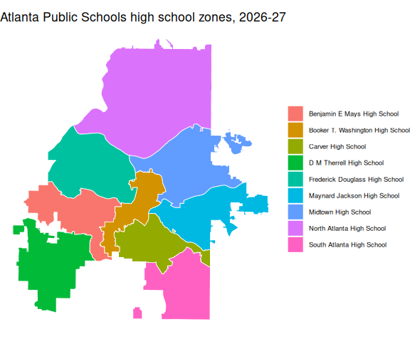

<!-- README.md is generated from README.Rmd. Please edit that file -->

# georgiacivicdata

<!-- badges: start -->

[](https://github.com/shanejorr/georgia-data-rpackage/actions/workflows/R-CMD-check.yaml)
[](https://lifecycle.r-lib.org/articles/stages.html#experimental)
<!-- badges: end -->

georgiacivicdata is an R client for the [Georgia Civic
Data](https://georgiacivicdata.org) API: cleaned public data about
Georgia’s schools and communities. It covers education (graduation, test
scores, enrollment, attendance, school accountability), U.S. Census
context, immigration and health, at state, county, school district,
school and Census tract level.

- **Tidy tibbles**, typed from each dataset’s schema: codes keep their
  leading zeros, years are integers, proportions stay on the 0-1 scale.
- **Names beside codes**: every district, school, county and tract code
  comes with its name, and you can filter by name
  (`district = "Fulton County"`).
- **School attendance zones and district boundaries** as ‘sf’ objects.
- **Locate points and addresses**: the county, tract, block group,
  school district and zoned schools for any location in Georgia.
  Addresses are geocoded on your computer with the U.S. Census geocoder
  and never reach the Georgia Civic Data API.

There is no API key and nothing to configure.

## Installation

Install the development version from GitHub:

``` r
# install.packages("pak")
pak::pak("shanejorr/georgia-data-rpackage")
```

## Find data

``` r
library(georgiacivicdata)

gcd_search("high school graduation", n = 5)
#> ℹ Lookup tables that match: "schools" and "districts". See `gcd_dimension()`.
#> # A tibble: 5 × 11
#>    rank name     title summary main_topic detail_levels year_min year_max score matched_on
#>   <int> <chr>    <chr> <chr>   <chr>      <list>           <int>    <int> <dbl> <list>    
#> 1     1 ccrpi_g… High… Georgi… education  <chr [3]>         2012     2025 0.364 <chr [7]> 
#> 2     2 graduat… Four… Share … education  <chr [3]>         2004     2025 0.314 <chr [7]> 
#> 3     3 high_sc… High… Counts… education  <chr [3]>         2011     2025 0.321 <chr [8]> 
#> 4     4 postsec… Post… How ma… education  <chr [3]>         2010     2023 0.244 <chr [5]> 
#> 5     5 postsec… Post… How ma… education  <chr [3]>         2008     2021 0.259 <chr [4]> 
#> # ℹ 1 more variable: matched_columns <list>
```

`gcd_datasets()` lists the whole catalog, about 176 datasets.

## Understand a dataset

``` r
gcd_columns("graduation_rate_4_year_cohort")[, c("column", "type", "role", "unit")]
#> # A tibble: 7 × 4
#>   column          type    role           unit      
#>   <chr>           <chr>   <chr>          <chr>     
#> 1 year            integer year           <NA>      
#> 2 district_code   string  fk_district    <NA>      
#> 3 school_code     string  fk_school      <NA>      
#> 4 demographic     string  fk_demographic <NA>      
#> 5 num_graduates   integer metric         count     
#> 6 num_cohort      integer metric         count     
#> 7 graduation_rate number  metric         proportion
```

`gcd_describe()` prints everything else: source, years, detail levels,
which columns need a single value, and the notes the data contract
declares.

## Get rows, by name or code

``` r
grad <- gcd_rows(
  "graduation_rate_4_year_cohort",
  district = "Fulton County",
  detail = "districts",
  demographic = c("all", "black", "hispanic", "white"),
  year = 2021:2025
)
#> ℹ Demographic groups overlap across categories and may overlap within a category
#>   (active_duty can be a subset of military_connected). Read the dataset's definitions and
#>   non_additive declarations. Use the published `all` total when available, never add it
#>   to its subgroups. Counts reconcile only for complete, disjoint groups; subgroup rates
#>   generally do not add to the overall rate.
#> ℹ `district_census_id` is a 5-digit Census school-district code, NOT a county FIPS, and a
#>   district is not 1:1 with a county — do not map these district rows as counties.
grad
#> # A tibble: 20 × 11
#>     year district_code district_name district_census_id district_type demographic
#>    <int> <chr>         <chr>         <chr>              <chr>         <chr>      
#>  1  2021 660           Fulton County 02280              standard      all        
#>  2  2021 660           Fulton County 02280              standard      black      
#>  3  2021 660           Fulton County 02280              standard      hispanic   
#>  4  2021 660           Fulton County 02280              standard      white      
#>  5  2022 660           Fulton County 02280              standard      all        
#>  6  2022 660           Fulton County 02280              standard      black      
#>  7  2022 660           Fulton County 02280              standard      hispanic   
#>  8  2022 660           Fulton County 02280              standard      white      
#>  9  2023 660           Fulton County 02280              standard      all        
#> 10  2023 660           Fulton County 02280              standard      black      
#> 11  2023 660           Fulton County 02280              standard      hispanic   
#> 12  2023 660           Fulton County 02280              standard      white      
#> 13  2024 660           Fulton County 02280              standard      all        
#> 14  2024 660           Fulton County 02280              standard      black      
#> 15  2024 660           Fulton County 02280              standard      hispanic   
#> 16  2024 660           Fulton County 02280              standard      white      
#> 17  2025 660           Fulton County 02280              standard      all        
#> 18  2025 660           Fulton County 02280              standard      black      
#> 19  2025 660           Fulton County 02280              standard      hispanic   
#> 20  2025 660           Fulton County 02280              standard      white      
#> # ℹ 5 more variables: demographic_label <chr>, demographic_category <chr>,
#> #   num_graduates <int>, num_cohort <int>, graduation_rate <dbl>
```

Every category the filters don’t exclude comes back, totals (`all`)
beside subgroups, so the API’s advisories print as messages: never add a
total to its subgroups, and a missing value (`NA`) usually means
**suppressed**, not zero.

## Lookup tables

``` r
gcd_dimension("schools", district = "Fulton County", school_level = "high",
              active = TRUE,
              columns = c("district_code", "school_code", "school_name", "locale"))
#> # A tibble: 22 × 4
#>    district_code school_code school_name                      locale
#>    <chr>         <chr>       <chr>                            <chr> 
#>  1 660           0106        Milton High School               suburb
#>  2 660           0118        Hapeville Charter Career Academy suburb
#>  3 660           0119        Cambridge High School            suburb
#>  4 660           0176        Banneker High School             suburb
#>  5 660           0191        Roswell High School              city  
#>  6 660           0198        Centennial High School           city  
#>  7 660           0203        Northview High School            suburb
#>  8 660           0205        Alpharetta High School           city  
#>  9 660           0291        Creekside High School            suburb
#> 10 660           0386        Independence High School         city  
#> # ℹ 12 more rows
```

## School zones and places

``` r
library(ggplot2)

zones <- gcd_school_zones(district = "Atlanta Public Schools", zone_level = "high")
ggplot(zones) +
  geom_sf(aes(fill = school_name), colour = "white", linewidth = 0.3) +
  labs(title = "Atlanta Public Schools high school zones, 2026-27", fill = NULL) +
  theme_void() +
  theme(legend.text = element_text(size = 7))
```



``` r
# The Georgia State Capitol
gcd_locate(address = "206 Washington St SW, Atlanta, GA 30334")[
  , c("geographic_type", "geographic_id", "geographic_name", "grades")
]
#> ℹ A zone is the default assignment, not the only option: a Georgia student may attend
#>   another public school by transfer, or a charter, magnet or other choice school. See
#>   attendance_rules for the main ways.
#> # A tibble: 7 × 4
#>   geographic_type   geographic_id geographic_name                               grades
#>   <chr>             <chr>         <chr>                                         <chr> 
#> 1 county            13121         Fulton                                        <NA>  
#> 2 tract             13121003500   Census Tract 35                               <NA>  
#> 3 block_group       131210035001  Block Group 1, Census Tract 35, Fulton County <NA>  
#> 4 school_district   761           Atlanta Public Schools                        <NA>  
#> 5 elementary_school 761-0199      Centennial Academy (Charter)                  K-5   
#> 6 middle_school     761-0199      Centennial Academy (Charter)                  6-8   
#> 7 high_school       761-4560      Midtown High School                           9-12
```

## Data license and citation

The data is published under the [Creative Commons Attribution 4.0
International license (CC BY
4.0)](https://creativecommons.org/licenses/by/4.0/): credit Georgia
Civic Data and the original source. `gcd_citation()` writes the
citation:

``` r
gcd_citation(grad)
#> [1] "Four-Year Cohort Graduation Rate. Georgia Civic Data (georgiacivicdata.org), CC BY 4.0. https://georgiacivicdata.org/api/v1/datasets/graduation_rate_4_year_cohort. Original source: Governor's Office of Education and Workforce Strategy (GOEWS, formerly GOSA)."
```

The package code is MIT-licensed.

## Learn more

- Package website: <https://georgiacivicdata.org/r/>
- Georgia Civic Data: <https://georgiacivicdata.org>
- API documentation: <https://georgiacivicdata.org/docs>
