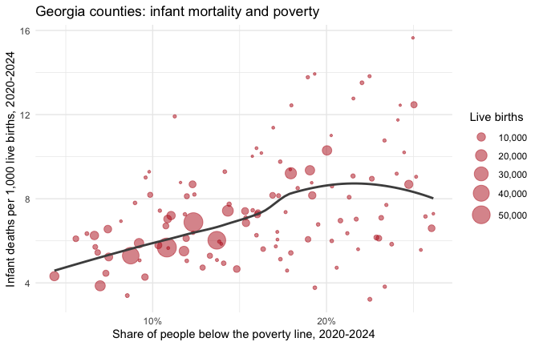
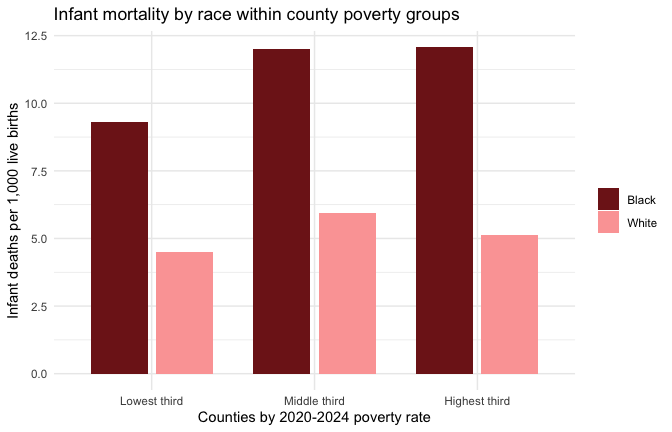
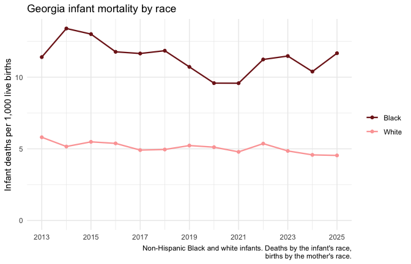

<!-- This vignette is precomputed: edit analysis.Rmd.orig and run
vignettes/precompile.R. It calls the live API, which CRAN builds can't. -->

This article puts two datasets side by side: infant mortality from the
Georgia Department of Public Health, and the poverty rate from the U.S.
Census. Infant mortality, the number of babies who die before their first
birthday per 1,000 live births, is one of the most widely used measures of
a community's health. The article shows the steps any such analysis needs:
pick the datasets, confirm they share a join key and years, read the
dataset's notes, pool rates from their counts, and respect breaks in a
series.


``` r
library(georgiacivicdata)
library(dplyr)
library(ggplot2)
```

## Pick the datasets


``` r
gcd_search("infant mortality", n = 3) |> select(name, title, year_min, year_max)
#> # A tibble: 3 × 4
#>   name           title                                         year_min year_max
#>   <chr>          <chr>                                            <int>    <int>
#> 1 infant_deaths  Infant Deaths and Infant Mortality Rates          2000     2025
#> 2 fetal_deaths   Fetal Deaths and Fetal Mortality Rates            2000     2025
#> 3 birth_outcomes Birth Outcomes (Low Birthweight and Preterm …     2000     2025
gcd_search("poverty rate", level = "counties", n = 3) |> select(name, title, year_min, year_max)
#> # A tibble: 3 × 4
#>   name                         title                           year_min year_max
#>   <chr>                        <chr>                              <int>    <int>
#> 1 poverty                      Poverty (ACS)                       2020     2024
#> 2 poverty_by_nativity          Poverty by Nativity and Citize…     2020     2024
#> 3 low_income_low_access_tracts Low-Income, Low-Access Tracts …     2025     2025
```

`infant_deaths` holds infant deaths and live births from the state's
OASIS system, by county of residence; `poverty` is the American Community
Survey (ACS) 5-year estimate of the share of people below the federal
poverty line. Before joining them, check that they share a detail level and
a key, and which years they cover:


``` r
infant_info <- gcd_describe("infant_deaths")
poverty_info <- gcd_describe("poverty")

intersect(infant_info$detail_levels, poverty_info$detail_levels)
#> [1] "counties" "states"
intersect(infant_info$grain, poverty_info$grain)
#> [1] "year"        "county_fips" "tract_geoid"
range(infant_info$years)
#> [1] 2000 2025
range(poverty_info$years)
#> [1] 2020 2024
```

Both publish county rows keyed by `county_fips`. The ACS figures are
5-year estimates named by their end year, so the 2024 vintage pools survey
responses from 2020 to 2024. We match it with the infant deaths of 2020 to
2024.

## Read the notes first

The dataset's notes say which columns can't be added up. Causes and ages
at death nest inside each other (`all` contains every cause, and
`neonatal` contains `early_neonatal`), so summing across them counts the
same deaths more than once:


``` r
infant_info$notes$non_additive$column
#> [1] "cause"        "age_at_death"
```

Pinning both to `all` gives one row per county, year and group. The notes
also set a floor on any figure we compute ourselves:


``` r
infant_info$notes$pooled_min_count$reason
#> [1] "OASIS withholds rates based on 1-4 deaths (shown as * on OASIS), so no figure combined from fewer than 5 deaths is given."
```

## Pool infant mortality from counts

`gcd_columns()` names the numerator and denominator of the rate:


``` r
gcd_columns("infant_deaths") |>
  filter(!is.na(metric_component)) |>
  select(column, metric_component)
#> # A tibble: 2 × 2
#>   column     metric_component
#>   <chr>      <chr>           
#> 1 num_deaths numerator       
#> 2 num_births denominator
```


``` r
infant <- gcd_rows(
  "infant_deaths",
  detail = "counties",
  demographic = "all",
  cause = "all",
  age_at_death = "all",
  year = 2020:2024,
  quiet = TRUE
)

infant |>
  summarise(county_years = n(),
            with_a_rate = sum(!is.na(death_rate_per_1k_births)),
            median_births = median(num_births))
#> # A tibble: 1 × 3
#>   county_years with_a_rate median_births
#>          <int>       <int>         <int>
#> 1          795         385           258
```

Infant deaths are rare, and most of Georgia's 159 counties are small: in a
typical county-year a few hundred babies are born, and a single death moves
the rate by several points. That is why about half of the county-years have
no published rate at all. A county's rate over several years is the sum of its
deaths over the sum of its births, not the average of its yearly rates:


``` r
pooled <- infant |>
  group_by(county_fips, county_name) |>
  summarise(
    deaths = sum(num_deaths),
    births = sum(num_births),
    .groups = "drop"
  ) |>
  mutate(infant_mortality = 1000 * deaths / births)

pooled |> arrange(desc(births))
#> # A tibble: 159 × 5
#>    county_fips county_name deaths births infant_mortality
#>    <chr>       <chr>        <int>  <int>            <dbl>
#>  1 13135       Gwinnett       323  56843             5.68
#>  2 13121       Fulton         389  56491             6.89
#>  3 13089       DeKalb         299  49609             6.03
#>  4 13067       Cobb           229  43244             5.30
#>  5 13063       Clayton        177  19212             9.21
#>  6 13051       Chatham        133  17899             7.43
#>  7 13057       Cherokee        59  15278             3.86
#>  8 13139       Hall            76  13787             5.51
#>  9 13245       Richmond       135  13110            10.3 
#> 10 13151       Henry           77  13077             5.89
#> # ℹ 149 more rows
sum(pooled$deaths < 5)
#> [1] 41
```

Even pooled over five years, 41 counties had fewer
than five infant deaths, too few for a rate under the dataset's own rule.
We keep their counts for the group sums below but leave them out of any
county-level figure.

Pooling and averaging give different answers whenever counties differ in
size. Here is the comparison with the published state rows:


``` r
state <- gcd_rows("infant_deaths", detail = "states", demographic = "all",
                  cause = "all", age_at_death = "all", year = 2020:2024,
                  quiet = TRUE)

pooled |>
  summarise(
    mean_of_county_rates = mean(infant_mortality),
    pooled_from_counts = 1000 * sum(deaths) / sum(births),
    births_counted = sum(births)
  ) |>
  mutate(state_pooled = 1000 * sum(state$num_deaths) / sum(state$num_births),
         state_births = sum(state$num_births)) |>
  as.data.frame()
#>   mean_of_county_rates pooled_from_counts births_counted state_pooled
#> 1             6.939697            6.65106         623660      6.65106
#>   state_births
#> 1       623660
```

The counties add up to the state row exactly, so the rate pooled from
county counts matches the state's. The plain mean of county rates is
further off, because it weighs a county with a hundred births like one with
fifty thousand.

## Join the poverty rate


``` r
poverty <- gcd_rows(
  "poverty",
  detail = "counties",
  year = 2024,
  race_iteration = "all",
  quiet = TRUE
) |>
  select(county_fips, poverty_rate, poverty_rate_moe)

joined <- inner_join(pooled, poverty, by = "county_fips")
nrow(joined)
#> [1] 159
```

The ACS reports a 90% margin of error beside each estimate; for small
counties it can be a sizable share of the estimate:


``` r
joined |>
  mutate(moe_share = poverty_rate_moe / poverty_rate) |>
  summarise(median_moe_share = median(moe_share), max_moe_share = max(moe_share))
#> # A tibble: 1 × 2
#>   median_moe_share max_moe_share
#>              <dbl>         <dbl>
#> 1            0.190         0.507
```


``` r
rated <- filter(joined, deaths >= 5)

ggplot(rated, aes(poverty_rate, infant_mortality)) +
  geom_point(aes(size = births), alpha = 0.5, colour = "#b91c1c") +
  geom_smooth(aes(weight = births), method = "loess", formula = y ~ x,
              se = FALSE, colour = "grey30") +
  scale_x_continuous(labels = scales::label_percent()) +
  scale_size_area(max_size = 8, labels = scales::label_comma()) +
  labs(
    x = "Share of people below the poverty line, 2020-2024",
    y = "Infant deaths per 1,000 live births, 2020-2024",
    size = "Live births",
    title = "Georgia counties: infant mortality and poverty"
  ) +
  theme_minimal()
```

<div class="figure">

<p class="caption">Each point is a county with at least five infant deaths in 2020-2024, sized by its births.</p>
</div>


``` r
cor(rated$poverty_rate, rated$infant_mortality, method = "spearman")
#> [1] 0.3697077
```

County by county the association is modest, a rank correlation of
0.37,
partly because even five-year rates in small counties carry a lot of chance
variation. Grouping counties
by their poverty rate and pooling each group's counts gives steadier rates.
Every county counts here, including those with too few deaths for a rate
of their own:


``` r
thirds <- joined |>
  mutate(poverty_group = cut(
    poverty_rate,
    quantile(poverty_rate, c(0, 1 / 3, 2 / 3, 1)),
    labels = c("Lowest third", "Middle third", "Highest third"),
    include.lowest = TRUE
  ))

thirds |>
  group_by(poverty_group) |>
  summarise(counties = n(),
            deaths = sum(deaths),
            births = sum(births),
            infant_mortality = 1000 * deaths / births)
#> # A tibble: 3 × 5
#>   poverty_group counties deaths births infant_mortality
#>   <fct>            <int>  <int>  <int>            <dbl>
#> 1 Lowest third        53   2345 395522             5.93
#> 2 Middle third        53   1229 155432             7.91
#> 3 Highest third       53    574  72706             7.89
```

Babies born in the middle and highest-poverty thirds of counties die
before their first birthday at a rate about a third higher than babies born
in the lowest-poverty third. The lowest-poverty third holds most of the
state's births, so it sets the state's rate.

## Poverty and race

Infant mortality in Georgia differs most of all by race. The `demographic`
filter gives the same counts for each racial and ethnic group; `black` and
`white` are non-Hispanic. Pooling them within the same county poverty
groups asks whether the county's poverty rate accounts for the gap:


``` r
infant_race <- gcd_rows(
  "infant_deaths",
  detail = "counties",
  demographic = c("black", "white"),
  cause = "all",
  age_at_death = "all",
  year = 2020:2024,
  quiet = TRUE
)

by_race <- infant_race |>
  inner_join(select(thirds, county_fips, poverty_group), by = "county_fips") |>
  group_by(poverty_group, demographic_label) |>
  summarise(deaths = sum(num_deaths),
            births = sum(num_births),
            infant_mortality = 1000 * deaths / births,
            .groups = "drop")

by_race
#> # A tibble: 6 × 5
#>   poverty_group demographic_label deaths births infant_mortality
#>   <fct>         <chr>              <int>  <int>            <dbl>
#> 1 Lowest third  Black               1104 118808             9.29
#> 2 Lowest third  White                747 166021             4.50
#> 3 Middle third  Black                684  56954            12.0 
#> 4 Middle third  White                399  67186             5.94
#> 5 Highest third Black                362  29989            12.1 
#> 6 Highest third White                165  32237             5.12
```


``` r
ggplot(by_race, aes(poverty_group, infant_mortality, fill = demographic_label)) +
  geom_col(position = position_dodge(width = 0.8), width = 0.7) +
  scale_fill_manual(values = c("#7f1d1d", "#fca5a5")) +
  labs(
    x = "Counties by 2020-2024 poverty rate",
    y = "Infant deaths per 1,000 live births",
    fill = NULL,
    title = "Infant mortality by race within county poverty groups"
  ) +
  theme_minimal()
```

<div class="figure">

<p class="caption">Infant mortality pooled from counts, 2020-2024, by county poverty group and race.</p>
</div>

In every poverty group, Black infants die at about twice the rate of white
infants. Black infants in the lowest-poverty counties die at a higher rate
than white infants in the highest-poverty counties. County poverty goes
with higher rates for Black infants, but it does not explain the gap
between the two groups.

## A trend that respects the series

To follow the gap over time, use the state rows, where the counts are
large enough for yearly rates. The notes decide which years can be
compared:

- Births to multiracial mothers jumped from hundreds a year to thousands
  in 2007 and 2008 while births to white mothers fell, most likely from
  Georgia's revised birth certificate. Death records kept the infant's race,
  so race-group rates in those years mix a recording change with real
  change. For counties, the notes advise comparing race-group rates over
  time from 2013 on; we use the same start for the state.
- OASIS says the 2010 rate is low from under-reporting, another reason to
  start after it.


``` r
state_race <- gcd_rows(
  "infant_deaths",
  detail = "states",
  demographic = c("black", "white"),
  cause = "all",
  age_at_death = "all",
  year = 2013:max(infant_info$years),
  quiet = TRUE
)
```


``` r
ggplot(state_race, aes(year, death_rate_per_1k_births, colour = demographic_label)) +
  geom_line(linewidth = 0.8) +
  geom_point(size = 1.5) +
  scale_colour_manual(values = c("#7f1d1d", "#fca5a5")) +
  scale_x_continuous(breaks = seq(2013, 2025, by = 2)) +
  expand_limits(y = 0) +
  labs(
    x = NULL, y = "Infant deaths per 1,000 live births",
    colour = NULL,
    title = "Georgia infant mortality by race",
    caption = "Non-Hispanic Black and white infants. Deaths by the infant's race,\nbirths by the mother's race."
  ) +
  theme_minimal()
```

<div class="figure">

<p class="caption">Georgia's published infant mortality rates by race, 2013 on.</p>
</div>

Yearly rates still move by a point or more from chance. Pooling a few
years at a time steadies them:


``` r
state_race |>
  mutate(period = cut(year, c(2012, 2016, 2020, 2025),
                      labels = c("2013-2016", "2017-2020", "2021-2025"))) |>
  group_by(period, demographic) |>
  summarise(infant_mortality = 1000 * sum(num_deaths) / sum(num_births),
            .groups = "drop") |>
  tidyr::pivot_wider(names_from = demographic, values_from = infant_mortality) |>
  mutate(ratio = black / white)
#> # A tibble: 3 × 4
#>   period    black white ratio
#>   <fct>     <dbl> <dbl> <dbl>
#> 1 2013-2016  12.4  5.46  2.27
#> 2 2017-2020  11.0  5.05  2.17
#> 3 2021-2025  10.9  4.82  2.25
```

The white rate has edged down since the mid-2010s. The Black rate fell to
its lowest in 2020 and 2021 and then rose again. Throughout, the Black rate
has stayed a little more than twice the white rate.

## What these figures can't tell

- **Association, not causation.** Poverty is one of many ways counties
  differ; nothing here says a county's poverty rate causes infant deaths.
- **Counties are not families.** A county's poverty rate describes all of
  its residents, not the families of the babies born there.
- **Estimates carry error.** The ACS poverty rate is a survey estimate
  with a margin of error, larger in small counties; a county near a group
  boundary could sit in either.
- **Race is recorded twice.** Deaths carry the infant's race from the death
  certificate and births the mother's from the birth certificate, so a
  group's rate can be biased where the two differ.
- **Small counts swing.** A county's rate on a few deaths says little on
  its own; group and pool before comparing places.
- **Infant mortality has many causes.** The dataset's `cause` and
  `age_at_death` filters split deaths into prematurity, birth defects,
  sudden infant death and others, which this article does not look at.
